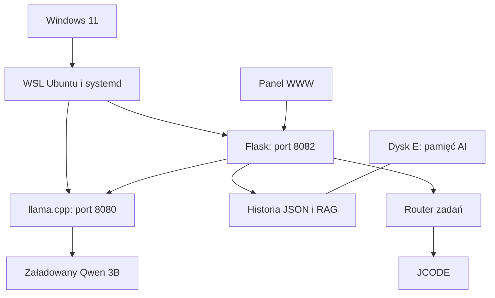
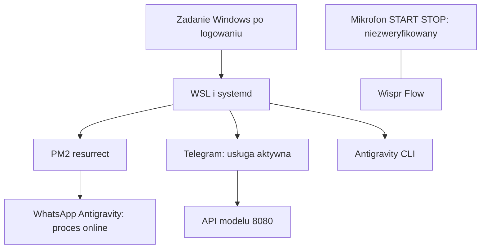

# Architektura MFO

[[START]] · [[MFO TURBO AI CENTER]]

Diagramy pokazują zależności potwierdzone konfiguracją lub kodem, nie wynik pełnych testów funkcjonalnych. Szczegółowe statusy i dowody są w notatkach modułów. Pełne relacje opisowe można eksplorować w widoku grafu, filtr `path:Moduly`.

## Rdzeń i dane

[[Llama]] to plik modelu obecny na dysku, nie dowód aktywnego załadowania. RAG i router mają potwierdzony kod, ale nie wykonano ich pełnego testu funkcjonalnego.

## Procesy towarzyszące

Nie potwierdzono przesyłania wiadomości, działania START/STOP ani pełnego startu po restarcie.

## Integracje bez potwierdzenia

[[GitHub]]: brak autoryzacji i potwierdzonego repozytorium docelowego. [[Linear]]: brak dowodu konfiguracji. Te notatki nie oznaczają działających integracji.

## Eksploatacja

[[Monitoring]] · [[Logi]] · [[Kopie bezpieczenstwa]] · [[Ochrona API]] · [[Autostart]]
